# System architecture and trust boundaries

Rhetrion is a local Windows x64 usage and quota companion. The independent
product has no cloud project, sharing, contribution upload, public site or
configured update feed. Removing old service source does not administer or
erase any former remote service. See the
[product decision](../decisions/2026-10-23-local-product-identity-and-cloud-retirement.md).
Codex is the only supported usage provider; legacy immutable records are
readback history only. The optional X reader remains a separate local metadata
feature under the [provider-scope decision](../decisions/2026-10-27-codex-only-product.md).

## Composition and ownership

`packages/codex-catalog` owns the local reviewed Codex plan and model vocabulary
through its public root entrypoint. Provider normalization, local analysis and
the generated dashboard catalog consume it independently of telemetry schemas.
Plan labels establish identity only; observed quota evidence and accounting
retain their existing owners. Local export v1 has a separate closed contract; retired telemetry and contribution
readers, generators and upload surfaces have been removed. File-transaction
recovery and frozen release evidence retain their own bounded historical readers.

```mermaid
flowchart LR
  Shell[Electron lifecycle and IPC] --> Companion[Loopback companion]
  UI[Sandboxed dashboard] --> Companion
  Companion --> Domain[Reviewed domain facades]
  Domain --> Index[(Owner-only local index)]
  Domain --> Reader[Bounded provider adapters]
  Shell --> Native[Windows filesystem and credential boundary]
```

`src/` owns ingestion, identity-scoped accounting and local analysis.
`apps/local` composes the loopback HTTP service; `apps/web` presents its validated
DTOs; `apps/electron` owns lifecycle, IPC, settings, tray and Windows integration.
Runtime-neutral packages are accessed through their public facades. Scripts and
tools consume these APIs in one direction; product code does not import tooling.
`pnpm run architecture:check` enforces these dependency boundaries.

## Stable application identity

`config/application-identity.cjs` is the machine-identity authority. The stable
App ID is `com.usagemonitor.local`, package `app-usagemonitor`, executable
`usage-monitor.exe` and app link `usagemonitor://open`. Exact package metadata,
platform, distribution and profile select runtime capabilities; display names
never select a credential, profile or production permission.

`config/product-brand.cjs` owns only names and artwork. CJS packaging and ESM
presentation consume it through the existing config boundary. Neutral i18n
catalogs interpolate a supplied name; generators materialize presentation copy
without adding a product-config dependency to the reusable package.

The executable composition pins `userData` to
`%APPDATA%/UsageMonitor/profiles/<profile>` and `sessionData` to its `chromium`
child before Electron readiness, creating protected directories through the
platform owner. Stable and development profiles do not overlap. Existing data
is not automatically discovered or imported by brand name. The separate one-time
migration must preserve original bytes, identities, salts, privacy choices and
accumulated evidence before activating a converted copy.
Its [owner-approved scope](../decisions/2026-10-25-usage-only-state-cutover.md)
is usage computation/history continuity only: the index and salt, collector,
timing, calculation baselines, retained usage evidence and necessary source/control
settings. X, background and generic Chromium state remain untouched at the
source; their migration or restart is not a usage-cutover prerequisite. No
whole-profile overlay or restore is authorized by this narrower transition.

## Local privacy and integrity

Local analysis works offline. HTTP binds only to loopback with explicit
Host/Origin and mutation-header checks; the API is not an arbitrary path or
remote proxy. Electron keeps sandboxing, context isolation, a narrow preload,
trusted-frame IPC and navigation/resource allowlists. App links contain only a
fixed wake target, never tokens, paths or renderer commands.

Raw prompts, responses, commands, credentials and session contents stay outside
derived artifacts. Owner-only local source paths never leave the machine.
Transient Projects & threads names have their separately approved local-display
boundary and are excluded from reports, exports, diagnostics and browser storage.
Unknown, stale, partial, unavailable and unattributed evidence remains explicit.
Accounting is replay-safe, bounded, deterministic and identity-scoped.

Schema evolution is forward-only. Older readers refuse newer state; they never
relabel versions, destructively downgrade or wipe data. Display windows are not
retention limits. Recovery diagnoses and rehearses against copies, preserving
original and post-cutover history. The optional X reader has an independent
protected browser session and public-post cache; it does not send local usage data.

## Verification and operation

Native claims, source tests, staging, GUI rendering, packaged apps, installed
lifecycle, signing and updates are separate evidence gates. Narrow native
capabilities do not enable disabled general production/path-walk policy.
No test or qualification marker may be applied to a real profile as a shortcut.

See [API boundaries](./api-surface.md), [schema lifecycle](./schema-contracts.md),
[privacy](./local-data-and-privacy.md), [recovery](../runbooks/local-index-recovery.md)
and [current status](../current-status.md). Publication and remote operations
require a separately configured and explicitly authorized workflow.
